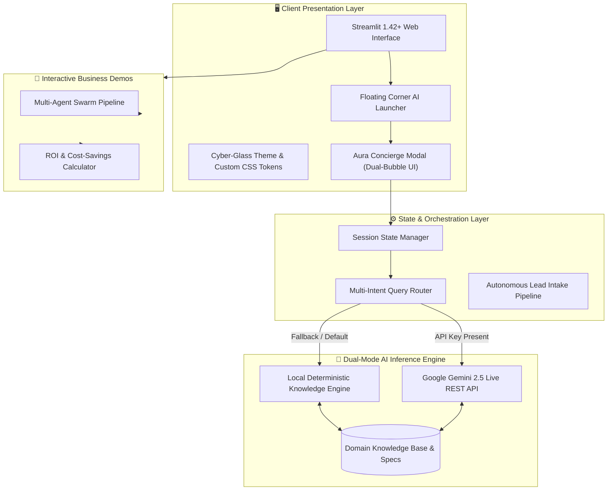

<div align="center">

# 🤖 Aura AI & Autonomous Business Engineering Portfolio
### *Production-Ready Multi-Agent Systems • 24/7 Client Concierge • Intelligent Automation*

<br/>

[](https://ai-folio.streamlit.app/)
[](https://python.org)
[](https://streamlit.io)
[](https://ai.google.dev/)
[](https://opensource.org/licenses/MIT)

<br/>

---

### 🌐 **Live Interactive Web Application**
### 👉 **[https://ai-folio.streamlit.app/](https://ai-folio.streamlit.app/)** 👈

*Experience the 24/7 live AI concierge, run interactive business automation simulations, and calculate enterprise ROI in real-time.*

---

[🚀 Launch Live App](https://ai-folio.streamlit.app/) • [✨ Core Features](#-core-features) • [🏛️ System Architecture](#️-system-architecture) • [⚡ Quickstart](#-quickstart-guide) • [📬 Contact Hadi](#-contact--hire)

</div>

<br/>

## 🌟 Executive Summary

Unlike standard static portfolio websites, **AI-Folio** is itself an **active, production-grade autonomous AI application**. Engineered specifically for businesses and non-technical stakeholders, it demonstrates how **Agentic AI** automates daily operations, drives lead conversion, and reduces manual overhead.

### 🎯 Key Highlights:
- 🤖 **Aura AI Client Concierge (24/7)**: An embedded autonomous assistant with comprehensive knowledge of Hadi's engineering capabilities, case studies, and services. Features dual-colored chat bubbles, mobile-responsive docking, and instant history clearing.
- ⚡ **Interactive Business Automation Lab**: Live simulation of autonomous multi-agent pipelines (News tracking, competitive intelligence, and automated briefings).
- 💰 **Business ROI & Time-Savings Calculator**: Interactive tool helping business owners quantify exactly how many hours and dollars AI automation saves every month.
- 🎨 **Cyber-Glass Dark Canvas**: High-contrast, responsive glassmorphism UI engineered with custom CSS, dark-mode tokens, and accessibility standards.

---

## ✨ Core Features

| Feature | Engineering Implementation | Business Value |
| :--- | :--- | :--- |
| **🤖 Aura AI Concierge** | Dual-mode hybrid engine: Live Google Gemini LLM REST API + local intent classifier with persistent session memory. | 24/7 immediate visitor qualification, automated inquiry handling, zero lead drop-off. |
| **⚡ Multi-Agent Swarm Lab** | 3-stage agent pipeline (`Researcher` $\to$ `Analyst` $\to$ `Synthesizer`) demonstrating autonomous tool execution. | Replaces 15+ hours/week of manual research and report generation. |
| **📊 ROI Savings Calculator** | Dynamic mathematical model evaluating staff hourly rates, recurring hours, and token overhead. | Quantifies upfront ROI and cost justification for executive decision-makers. |
| **🎨 Responsive Cyber UI** | Custom CSS layout with pinned floating launcher, dual-colored message bubbles, and mobile-first responsiveness. | Seamless user experience for non-technical clients across desktop and mobile. |

---

## 🏛️ System Architecture

The application is structured into decoupled orchestration, inference, state management, and visual presentation layers:



---

## 💻 Technology Stack

```
Runtime Environment:   Python 3.11
Application Framework: Streamlit >= 1.35.0 (Running 1.42+)
AI & LLM Integration:  Google Gemini REST API, Custom NLP Inference
Data Processing:       Pandas >= 2.0.0
Styling & Theming:     Custom CSS3, Modern Glassmorphism, Responsive Flexbox
Deployment Platform:   Streamlit Community Cloud (Continuous Deployment via GitHub)
```

---

## 🚀 Quickstart Guide

Run the complete portfolio locally in less than 2 minutes:

### 1. Clone the Repository
```bash
git clone https://github.com/SainBux-HadiSeelro/ai-folio.git
cd ai-folio
```

### 2. Set Up Virtual Environment (Recommended)
```bash
# Windows (PowerShell):
python -m venv .venv
.venv\Scripts\Activate.ps1

# Linux / macOS:
python3 -m venv .venv
source .venv/bin/activate
```

### 3. Install Dependencies
```bash
pip install -r requirements.txt
```

### 4. Run the Application
```bash
streamlit run app.py
```
Your default browser will automatically open at `http://localhost:8501`.

### 5. (Optional) Configure Live Gemini API Key
To enable live generative LLM responses, set your Google Gemini API key:
- **Locally:** Add `.streamlit/secrets.toml`:
  ```toml
  GEMINI_API_KEY = "AIzaSy..."
  ```
- **In-App:** Enter your key directly in Aura's chat settings expander.
- **On Streamlit Cloud:** Add `GEMINI_API_KEY` under **App Settings $\to$ Secrets**.

---

## 📁 Repository Structure

```text
ai-folio/
├── .streamlit/
│   └── config.toml          # Custom dark mode palette & server configuration
├── .python-version          # Pinned to Python 3.11 for cloud build stability
├── app.py                   # Main application, UI components & Aura AI engine
├── requirements.txt         # Production-locked dependencies
├── README.md                # Comprehensive documentation
└── specs/
    └── project-specs.md     # Deep-dive architecture specifications
```

---

## 🛡️ Enterprise Security & Guardrails

- **Zero Data Leakage:** Chat sessions reside strictly in client-side ephemeral memory (`st.session_state`) with zero cross-tenant bleed.
- **Strict Guardrails:** The local deterministic engine enforces factual boundaries directly from Hadi's verified business knowledge base, preventing hallucinations.
- **Graceful Fallback:** If the external LLM API encounters network latency or rate-limiting, the system automatically falls back to the deterministic local engine without user disruption.

---

## 📬 Contact & Hire

Looking to build 24/7 custom AI chatbots, automate repetitive business workflows, or integrate agentic AI pipelines into your company?

- 🌐 **Live Web Application:** [ai-folio.streamlit.app](https://ai-folio.streamlit.app/)
- 👤 **AI Systems Architect:** Hadi Seelro
- 🐙 **GitHub Repository:** [github.com/SainBux-HadiSeelro/ai-folio](https://github.com/SainBux-HadiSeelro/ai-folio)
- 🟢 **Availability:** Open for Custom Business AI Projects, Contract Roles & Consulting

---

<div align="center">
  <sub>Built with ❤️ by <b>Hadi Seelro</b> • © 2026 All Rights Reserved.</sub>
</div>
