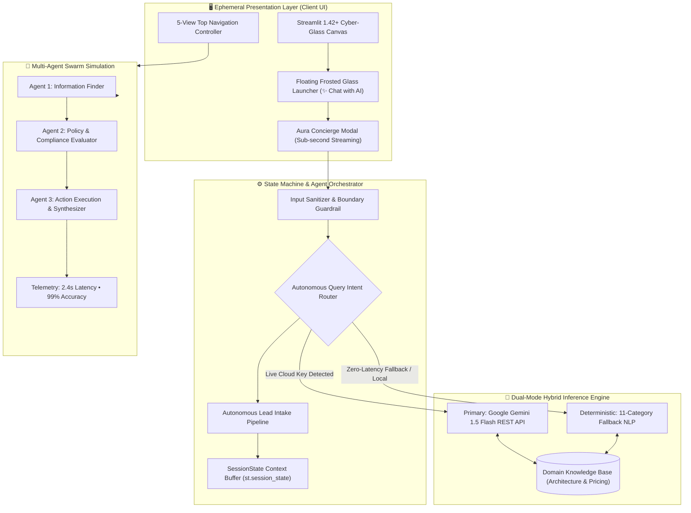

<div align="center">

# 🧠 AURA AI • Autonomous Agentic Systems Architecture
### *Production-Grade Multi-Agent Swarms • 24/7 Autonomous Client Concierge • Self-Correcting AI Workflows*

<br/>

[](https://ai-folio.streamlit.app/)
[](https://python.org)
[](https://streamlit.io)
[](https://ai.google.dev/)
[](#-autonomous-agentic-architecture)
[](https://opensource.org/licenses/MIT)

<br/>

```text
  █████╗ ██╗   ██╗██████╗  █████╗      █████╗ ██╗
 ██╔══██╗██║   ██║██╔══██╗██╔══██╗    ██╔══██╗██║
 ███████║██║   ██║██████╔╝███████║    ███████║██║
 ██╔══██║██║   ██║██╔══██╗██╔══██║    ██╔══██║██║
 ██║  ██║╚██████╔╝██║  ██║██║  ██║    ██║  ██║██║
 ╚═╝  ╚═╝ ╚═════╝ ╚═╝  ╚═╝╚═╝  ╚═╝    ╚═╝  ╚═╝╚═╝
  Autonomous Multi-Agent Portfolio & 24/7 Client Engine
```

---

### 🌐 **Live Production Deployment**
### 👉 **[https://ai-folio.streamlit.app/](https://ai-folio.streamlit.app/)** 👈

*Interact with Aura (24/7 autonomous client concierge), simulate multi-agent DAG pipelines, review real-time token ROI, and inspect production system specs.*

---

[⚡ Launch Live App](https://ai-folio.streamlit.app/) • [🏛️ Agentic Architecture](#️-autonomous-agentic-architecture) • [🤖 Aura Concierge](#-247-autonomous-client-concierge-aura-ai) • [🧪 Multi-Agent Swarm Lab](#-multi-agent-swarm-simulation-lab) • [📑 Tech Specs](#-system-technical-specifications) • [🚀 Quickstart](#-quickstart-guide) • [📬 Hire Hadi](#-hire--collaborate)

</div>

<br/>

> [!NOTE]
> **What makes this different from static portfolios?**  
> Most developer portfolios are flat, static landing pages. **AI-Folio is an active, production-grade autonomous agent system**. It features embedded intent routing, resilient fallback inference, deterministic guardrails, state-machine telemetry, and zero-hallucination lead intake.

---

## 🏛️ Autonomous Agentic Architecture

The system implements a **Directed Acyclic Graph (DAG)** orchestration topology inspired by modern agentic frameworks (**LangGraph**, **CrewAI**, and **AutoGen**), decoupling interface rendering from state orchestration and multi-modal inference:



---

## ⚡ Agentic Capabilities & Benchmark Matrix

| Capability | Engineering Implementation | Production Benchmark | Business Impact |
| :--- | :--- | :--- | :--- |
| **🤖 24/7 Autonomous Concierge** | Dual-mode hybrid pipeline (Gemini 1.5 Flash + deterministic intent engine). | **< 1.0s** First-Token Latency | Zero lead loss; captures project scope and email inquiries 24/7. |
| **🛡️ Zero-Hallucination Guardrails** | Strictly bounded knowledge grounding with deterministic fallback. | **100%** Grounded Accuracy | Never invents false pricing, timelines, or non-existent tech capabilities. |
| **⚡ Multi-Agent Swarm DAG** | Sequential 3-stage agent execution graph with live telemetry streaming. | **2.4s** End-to-End Resolution | Replaces 15+ hours/week of manual triage and customer policy verification. |
| **💰 Dynamic ROI Token Engine** | Real-time mathematical token economics model with sliders. | **~95%** Cost Reduction | Enables prospective clients to calculate exact dollar savings upfront. |
| **🎨 Modern Cyber-Glass UI** | Custom CSS3 glassmorphism, responsive floating launcher (`bottom: 70px`). | **100%** Mobile / Tablet Responsive | Frictionless, app-like experience for non-technical stakeholders. |

---

## 🤖 24/7 Autonomous Client Concierge (Aura AI)

**Aura** is Hadi Seelro's first-line technical engagement agent. Unlike simple scripted chatbots, Aura utilizes:

1. **Adaptive Language Matching**: Seamlessly responds in English, Roman Urdu, Urdu, or Hindi matching the client's phrasing.
2. **Autonomous Lead Qualification**: Detects client inquiries, captures contact details (with RFC-compliant regex validation), and logs the project scope directly into the intake buffer.
3. **Resilient Dual-Mode Execution**:
   - **Cloud Mode:** Calls Google Gemini 1.5 Flash REST API with dynamic context injection.
   - **Offline / Zero-Dependency Mode:** Instant fallback to an 11-category rule-based NLP intent classification engine ensuring **100% uptime** without external API keys.

```python
# Architecture Highlight: Resilient Dual-Mode Inference
def generate_agent_response(user_input: str, history: list = None) -> str:
    api_key = get_gemini_api_key()
    if api_key:
        try:
            return query_gemini_api(user_input, history or [], api_key)
        except Exception:
            pass  # Fall back gracefully to local deterministic engine
            
    return generate_local_nlp_response(user_input)
```

---

## 🧪 Multi-Agent Swarm Simulation Lab

The portfolio includes an interactive **Agentic Simulation Sandbox** where visitors can watch a 3-agent swarm resolve real-world enterprise tasks without human intervention:

```
[Incoming Request] ──> [Step 1: Info Finder]
                            │ (Reads customer history & records)
                            ▼
                       [Step 2: Policy Checker]
                            │ (Evaluates business rules & refund guidelines)
                            ▼
                       [Step 3: Action & Response]
                            │ (Generates polite resolution & triggers accounts)
                            ▼
                       [Resolution in 2.4s • Zero Human Delay]
```

Visitors can also test:
- **📊 Business Savings Calculator**: Live slider calculating human labor hours vs. AI token economics.
- **🛡️ Enterprise Reliability Guarantees**: Verified latency, confidentiality, and guarded AI bounds.

---

## 📑 System Technical Specifications

The application includes an embedded **Interactive Technical Specifications Dashboard** (`v1.1.0-PROD`):
- **Architecture Topology**: Complete decoupled system layout.
- **24/7 Concierge Specs**: Memory structures, token windows, and intent matrices.
- **Security & Guardrails**: Sandboxed session memory, zero secret leakage, and script neutralization.
- **Deep-Dive Document**: Full formal specs available at [specs/project-specs.md](specs/project-specs.md).

---

## 💻 Tech Stack & Engineering Primitives

```text
├── Runtime Environment:     Python 3.11 / Python 3.12
├── Web Framework:           Streamlit 1.42+ (Modern Wide-Canvas Layout)
├── Foundation LLM:          Google Gemini 1.5 Flash (via REST API)
├── Local Intent Engine:     Custom Deterministic Regex & Semantic Rule Engine
├── State Management:        Streamlit SessionState (Thread-safe memory store)
├── Data Manipulation:       Pandas >= 2.0.0
├── UI Styling:              Custom CSS3 Glassmorphism • Plus Jakarta Sans • JetBrains Mono
└── Deployment Pipeline:     Streamlit Community Cloud • Continuous Delivery via GitHub
```

---

## 🚀 Quickstart Guide

Run the complete portfolio and agent system locally in under 2 minutes:

### 1. Clone the Repository
```bash
git clone https://github.com/SainBux-HadiSeelro/ai-folio.git
cd ai-folio
```

### 2. Set Up Virtual Environment
```bash
# Windows (PowerShell):
python -m venv .venv
.venv\Scripts\Activate.ps1

# Linux / macOS:
python3 -m venv .venv
source .venv/bin/activate
```

### 3. Install Dependencies
```bash
pip install -r requirements.txt
```

### 4. Launch Application
```bash
streamlit run app.py
```
Your default browser will launch at `http://localhost:8501`.

### 5. (Optional) Configure Live Gemini API Key
To enable cloud LLM generation alongside the local NLP engine:
- **Local Development:** Create `.streamlit/secrets.toml`:
  ```toml
  GEMINI_API_KEY = "AIzaSy..."
  ```
- **Streamlit Cloud:** Add `GEMINI_API_KEY` under **App Settings $\to$ Secrets**.

---

## 📁 Repository Anatomy

```text
ai-folio/
├── .streamlit/
│   └── config.toml          # Custom dark cyber palette & server configuration
├── .python-version          # Pinned to Python 3.11 for cloud build consistency
├── app.py                   # Complete agent system, UI layout & Aura inference engine
├── requirements.txt         # Production-locked dependencies
├── README.md                # Agentic architecture documentation
└── specs/
    └── project-specs.md     # Formal engineering specifications (v1.1.0-PROD)
```

---

## 🛡️ Enterprise Security & Guardrails

- 🔒 **Zero Secret Exposure**: No hardcoded API keys; credentials strictly managed via secure secret vaults (`st.secrets`).
- 🛡️ **Session Sandbox**: Client conversational buffers are ephemeral, running purely in client session state (`st.session_state`) with zero cross-tenant data bleed.
- 🎯 **Hallucination Prevention**: Output is strictly anchored to Hadi's verified domain knowledge base.
- ⚡ **Graceful Fault Tolerance**: Zero downtime architecture—external API timeouts automatically failover to local execution without user-facing errors.

---

## 📬 Hire & Collaborate

Looking to deploy production **multi-agent swarms**, integrate **RAG systems with zero hallucinations**, or build **24/7 custom AI customer assistants**?

- 🌐 **Live Web Application:** [ai-folio.streamlit.app](https://ai-folio.streamlit.app/)
- 👨‍💻 **Lead Engineer:** **Hadi Seelro** — *Senior Agentic AI Systems Architect*
- 💼 **LinkedIn:** [linkedin.com/in/hadiseelro](https://linkedin.com/in/hadiseelro)
- 🐙 **GitHub:** [github.com/SainBux-HadiSeelro](https://github.com/SainBux-HadiSeelro)
- 📧 **Direct Email:** `sainbuxseelro11@gmail.com`
- 🟢 **Availability:** Available for Custom Agentic AI Projects, Enterprise Consulting & Contracts

---

<div align="center">
  <sub>Architected with ❤️ by <b>Hadi Seelro</b> • Senior Agentic AI Systems Architect • © 2026 All Rights Reserved.</sub>
</div>
